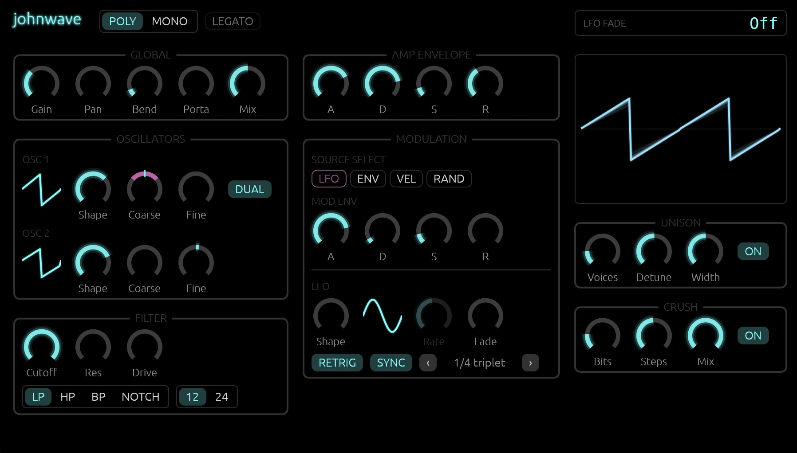

# johnwave

A wave-morphing synth plugin (CLAP + VST3), built in Rust with [nice-plug](https://crates.io/crates/nice-plug) and an egui UI.



## Getting started

* Check out the [user manual](/docs/user_manual.md)

## Requirements

- Stable Rust, installed via [rustup](https://rustup.rs)

## Test

```sh
cargo test
```

Unit tests live alongside the code in `src/*.rs`.

## Build

```sh
cargo xtask bundle johnwave --release
```

This writes the plugin bundles to:

- `target/bundled/johnwave.vst3`
- `target/bundled/johnwave.clap`

Leave off `--release` for a faster, unoptimised debug build.

## UI dev loop (standalone)

For UI work you can run johnwave as its own app, without a DAW:

```sh
cargo dev
```

This opens the plugin window and plays through CoreAudio, taking notes from the
default MIDI input. Options go after the command, e.g. `cargo dev --tempo 90`;
`cargo dev --help` lists them all.

To rebuild and relaunch on every save, use [watchexec](https://github.com/watchexec/watchexec)
(`brew install watchexec`):

```sh
watchexec -r -e rs -- cargo dev
```

The standalone app uses the same synth and editor code as the plugin, but nothing
sits around it the way a DAW would:

- the tempo is fixed and there's no song position, so tempo-synced LFOs can't lock to a playing song
- nothing is saved, so every relaunch starts from default settings
- nothing changes parameters from outside (no automation)
- it's a debug build, so it's slower than the release plugin

Use it for layout, drawing, knob feel and the scope. Check automation, tempo
sync, saving/reloading and performance in Ableton with a bundled build.

## Deploy (macOS)

Copy the bundles into your user plug-in folders:

```sh
mkdir -p ~/Library/Audio/Plug-Ins/VST3 ~/Library/Audio/Plug-Ins/CLAP
cp -R target/bundled/johnwave.vst3 ~/Library/Audio/Plug-Ins/VST3/
cp -R target/bundled/johnwave.clap ~/Library/Audio/Plug-Ins/CLAP/
```

Then rescan in your DAW. In Ableton: **Settings → Plug-Ins → Rescan**.

For quick iteration you can skip copying: point Ableton's custom VST3
folder at `target/bundled` and just rebuild + rescan.

## Todo

- readout bugginess in mod mode
  - show mod adjustments in readout
  - "mod wizard" text is too long to fit in readout
- second lfo and second mod env (and/or use amp env as a mod source)
- ability to type in param values (with left click?)
- a second filter
- 2× oversampling around the filter, to cut back on Drive's aliasing turns
- small line in center of polar knobs (inside the arc ring)
- play with the colours. They're all in `src/editor.rs`:
  - `cyan()` and `CYAN_HUE`: the main neon cyan (knob arcs, title, chips)
  - `neon_color()`, `HUE_DRIFT`, `SATURATION`: how the scope's lines shift from cyan as Osc 1's Shape goes up
  - `OUT_COLOR`, `OUT_GLOW`: the scope's soft white OUT line (and the FREQ view's spectrum, which uses the same white)
  - `SPECTRUM_FILL`, `SPECTRUM_EDGE`: how bright the spectrum's fill and its top edge are
  - `COMPONENT_STRENGTH`, `TRAIL_STRENGTH`: how faint the thin Osc 1/Osc 2 lines and the trail are
  - `mod_pink()`: the mod colour (mod arcs, mod mode)
  - `panel_gray()`: panel outlines and titles
